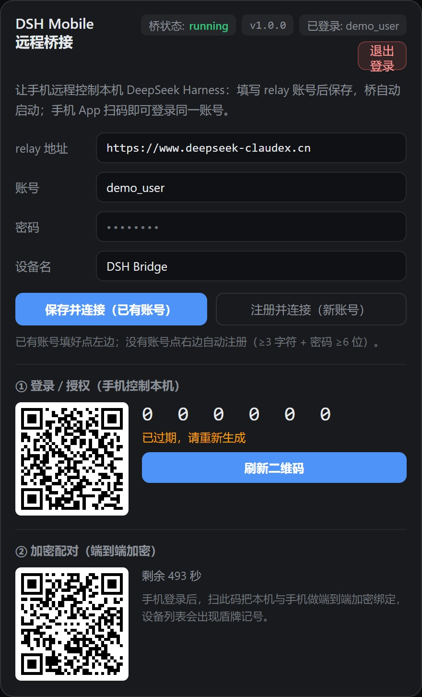

# @zdx8637/dshmobile-bridge

[English version](./README.md)

**开箱即用的手机远程桥接**：装一次即用，无需任何网络配置、无需本地补丁，
重启 dsh 后左侧栏即出现常驻二维码面板（跨平台，DSH 升级免疫）。

- **常驻二维码**（Web 左侧栏底部箭头弹窗）：与登录态无关，永远可扫——
  · 电脑已登录 → 手机（哪怕未登录）扫码直接登录同账号；
  · 电脑未登录 → 手机（已登录）扫码授权，电脑自动登录；
- **bridge 子进程守护**：账号密码模式或手机授权 token 模式（无密码直连，401 自动刷新）；
- 手机端一码三用：微信扫=下载 App、相机扫=跳 App 配对、App 内扫=直接登录/授权。

<p align="center"></p>

## 安装

**先选方式**：DSH **桌面版 0.2.0 及以上** → 用 §A（GUI，推荐）；旧版 `dsh web`（**0.1.7**）→ 用 §B（CLI）。
两种方式装的是同一个包：`@zdx8637/dshmobile-bridge`（当前版本 **1.0.10**）。

### A. DSH 0.2.0 桌面版：GUI 安装（推荐）

1. 打开 DSH 桌面版 → 插件管理器 → 点 **「添加插件」**；
2. 在输入框里粘贴**带精确版本号**的包名（输入框提示原文是「输入插件的包名、GitHub 仓库地址或
   本地目录路径。」，GitHub 仓库地址与本地目录路径它同样接受）：

   ```
   @zdx8637/dshmobile-bridge@1.0.10
   ```

3. 右侧 **「安装源」** 按网络情况选 `npm 官方源` 或 `中国大陆镜像源`；
4. 点安装；
5. **重启 DSH**（宿主需要重新加载插件才会生效）；
6. 打开面板：Web 左侧栏底部出现 ▶ 箭头，点开即配置面板。

> ⚠️ **务必带上精确版本号**（如 `@zdx8637/dshmobile-bridge@1.0.10`）。
> profile 目录里有 `pnpm-lock.yaml`，只写包名重装时锁文件可能把版本钉回旧的
> （实测：线上已经发到 1.0.2，重装后却仍然是 1.0.0）。

> ⚠️ **没有自动更新。** 弹窗原文：「插件安装后，暂不支持自动更新。若需升级，请先卸载再安装新版」。
> 升级 = 先在插件管理器里**卸载**，再按上面的步骤装上带新版本号的包名。

### B. DSH 0.1.7（旧版：`dsh web` + CLI）：CLI 安装

```sh
npx -y @deepseek-ai/dsh plugin --profile web add @zdx8637/dshmobile-bridge@latest
# 重启 dsh 后，Web 左侧栏底部出现 ▶ 箭头，点开即配置面板
```

前置：本机需要 `pnpm`（`dsh plugin` 子命令依赖它；`corepack enable` 或
`npm i -g pnpm`）。

> 仅限旧版：`@deepseek-ai/dsh` 的 npm `latest` 指向 0.1.7 的 CLI，所以这条命令拿到的是
> 0.1.7 的 `dsh plugin`。**0.2.0 及以上请改用上面的 §A（GUI）**，CLI 不是 0.2.0 的安装路径。

手机 App：扫描面板二维码 → 落地页下载 APK（或从
[发布页](https://github.com/zdx8637-gitdog/dshmobile/releases)获取）。

## 免补丁：面板走官方通道，旧 HTTP 通道保留兜底

DSH 0.1.0-rc.6 默认不向浏览器暴露第三方 settings 命名空间（上游标注为
deferred work）。本插件**不依赖该通道**：面板与宿主优先走**官方连接服务的 RPC 通道**
（`ctx.connection.rpc`，通道名 `/dshmobile`，同源相对路径，不依赖页面 origin），
探测不到该服务时自动退回 `127.0.0.1:17653` 的本地 HTTP（轮询状态 + 下发动作，
CORS 回显请求方 origin）。两条通道共用同一份数据与同一批动作，因此

- 装一次即用，**无需任何本地补丁**；
- Windows/macOS/Linux 通用；
- 桌面版（窗口 origin 为 `dsh-app://app`）与 `dsh web` 都能工作；
- DSH 升级不受影响（历史版本 0.1.0-beta.3 及更早需要 `scripts/expose-settings-namespace.ps1` 补丁，已废弃）。

## DSH 版本要求（只支持 v0.1.5+）

v0.1.5 起 DSH 给本地 Web 服务加了浏览器会话鉴权（`dsh web` 打印的 URL 里带
进程级 launch token → 浏览器换会话 Cookie，`/api` 全部请求校验），并把 RPC
协议升级为 Typert 端点（`session/list`、`{args}` 载荷、`/api/remote.mux`
流复用、`$events` 审批/提问瀑布）。插件 0.1.0-beta.17 起适配该协议：

- host 半边经 `ctx.connection.authenticatedUrl()` 取 launch token 交给桥子进程；
- 桥一次性换 Cookie（HMAC 签名、30 天有效），缓存于状态目录、401 自动重铸，
  所有 `/api` 请求与 WS 升级携带 Cookie；
- 会话/工作区/命令端点映射到新协议，事件流走 `/api/remote.mux` 的
  `session/follow` + `workspace/follow` + `session/control`，审批/提问走
  `$events` + `$events/result`。

> ⚠️ **自 0.1.0-beta.23 起不再支持旧版 DSH（≤ v0.1.0-rc.6）**：原先的"双协议自适应"
> （legacy：点号端点、裸 payload、`events.mux`/`events.host`、`/api/respond`、无鉴权直连）
> 已整体删除，协议面只留一条：**adapter −283 行 / dsh −59 / main −21 / host −8**，
> 另删掉整条"仿旧版 DSH"的 smoke 脚本。请确保 **DSH ≥ v0.1.5**；
> 若桥连不上 DSH，会在 `bridge.log` 给出明确提示：
> 「v2 协议握手失败：请确认 DSH 正在运行（dsh web）；本插件版本已不再支持旧版 DSH（≤0.1.5-rc.6）」。

自检脚本：`node scripts/smoke-dsh-v2.mjs`（仿新版 DSH 全链路）、
`node scripts/probe-real-dsh.mjs`（对运行中真实 DSH 只读验证，需本机浏览器
已登录过一次 Web 面板以生成签名密钥）、
`node scripts/archive-session.mjs --list | --newest-idle`（安全清理闲置会话；默认**拒绝**归档活跃会话）、
`node scripts/unarchive-session.mjs <id>` 与 `node scripts/probe-session-archive.mjs <id>`
（DSH 没有"取消归档"接口：归档集合在宿主内存里，改状态文件后需重启 DSH 才生效——细节与检查清单见
[docs/dsh-session-archive.md](https://github.com/zdx8637-gitdog/dshmobile/blob/main/docs/dsh-session-archive.md)）。

## 单实例保护（防"两个桥互相顶替"）

同一台机器上如果同时跑着两个桥（多开了一个 DSH、上次 DSH 被强杀留下的孤儿桥、或新旧插件混跑），
它们共用同一份状态目录 `~/.dsh-mobile` ⇒ **同一个 relay 设备身份** ⇒ 在 relay 侧互相把对方踢下线，
手机端表现为"**登录后刷新不出会话**"。自 0.1.0-beta.23 起有四层防护：

- **桥侧单例锁**：按状态目录散列出一个本机回环端口当锁（进程退出即自动释放）；新实例会请旧实例"让位"，
  让位失败则以退出码 42 退出，绝不并存；
- **宿主接管**：每次启动桥之前先结束本机其它桥进程（更新/重启 DSH 时会顺手清掉旧孤儿，保证新代码在跑）；
- **父进程看门狗**：宿主消失时桥立即退出，不再产生孤儿；
- **桥侧自愈**：若被 relay 按 `4000 duplicate connection` 反复顶替（说明本机还有**老版本**桥），
  主动清理其它桥进程。

面板入口的状态点会显示「另一个桥实例在运行」；此时在面板**保存一次**或重启 DSH 即可重新接管。
诊断用 `~/.dsh-mobile/bridge.lock.json` 与 `bridge.log`（UTF-8）。
**临时第二桥**（做 UI 验证时）请用独立状态目录并加 `--state-dir=<该目录>` 参数，或设
`DSHMOBILE_BRIDGE_SINGLETON=0`。细节见
[docs/bridge-singleton.md](https://github.com/zdx8637-gitdog/dshmobile/blob/main/docs/bridge-singleton.md)。

## relay 说明

插件默认连接 `https://www.deepseek-claudex.cn`（作者自营 relay：账号注册、
设备管理、消息路由均走该服务器）。也可自建：见主仓库
[dshmobile](https://github.com/zdx8637-gitdog/dshmobile) 的 `relay/` 目录与
`dsh-remote/docs/04-operations.md`，然后在面板里把 relay 地址改成你自己的。

## 开发

```sh
npm install
node scripts/build.mjs                  # 产出 lib/index.js + lib/client.js
node scripts/smoke-host.mjs <u> <p>     # 账号密码模式冒烟
node scripts/smoke-grant.mjs <u> <p>    # 手机授权模式冒烟
```

完整三端（手机 App / relay / 协议）见主仓库
[zdx8637-gitdog/dshmobile](https://github.com/zdx8637-gitdog/dshmobile)。

## 跨机 Superagent（1.1.0+）

让 Agent 把任务派给账号下**其它电脑**上的 Agent，结果自动回传（仅限同账号）。默认关闭。

### 开启 / 关闭

1. relay 启动时带 `REMOTE_RPC=on`（新增 `POST /devices/:id/rpc`；不带时该路由 404，其余不变）。这是服务端统一开关。
2. 本插件**默认开启**：可直接在侧边栏面板点 **Superagent → 关闭/开启**，或编辑 `~/.dsh-mobile/multi-agent.json`：

   ```json
   { "enabled": false }
   ```

   删除该文件即回到默认（开启）。关闭时不注册工具、不建定时器、不发请求。

### 工具

| 工具 | 用途 |
|---|---|
| `computers_list` | 本账号电脑与在线状态 |
| `sessions_list(computer, limit?)` | 某台电脑的会话（含 **cwd**、运行状态） |
| `agent_run(computer, prompt, sessionId?/cwd?, idemKey?, softTimeoutMs?, depth?, chain?)` | 以 **DSH 后台 job** 形式派活并收集最终回复；用内建 `job_output` 读取 |
| `remote_jobs(computer, sessionId)` | 远端会话的后台任务（需目标机为新版桥） |
| `remote_job_output(computer, sessionId, jobId, offset?)` | 读远端任务输出 |
| `remote_job_kill(computer, sessionId, jobId, reason?)` | 终止远端任务 |

### 语义

- `agent_run` 立即返回 `jobId`；远端回合以历史里的 `turn/end` 判定，网络抖动/`409` 不会误判失败；连续约 30 秒不可达才报 `remote-unreachable`。
- 原生集成：这组工具属于 DSH 原生工具系统，任务以 DSH 后台 job 运行（关掉对话也会继续），远端执行同样受沙盒与审批策略约束。
- **软超时**（默认 30 分钟）：任务继续跑，主 Agent 收到提醒后自行决定继续等待或 `job_kill`。
- `idemKey` 幂等：同 key 复用同一任务，避免重复派发。
- 护栏：链式 `depth` ≤ 3、`chain` 命中目标即拒绝、每会话最多 2 个 `remote-agent` 任务。
- 老桥（DSH ≤ 0.2.1）仍支持 `computers_list` / `sessions_list` / `agent_run`；仅 `remote_job_*` 需要目标机升级桥。

## License

MIT
